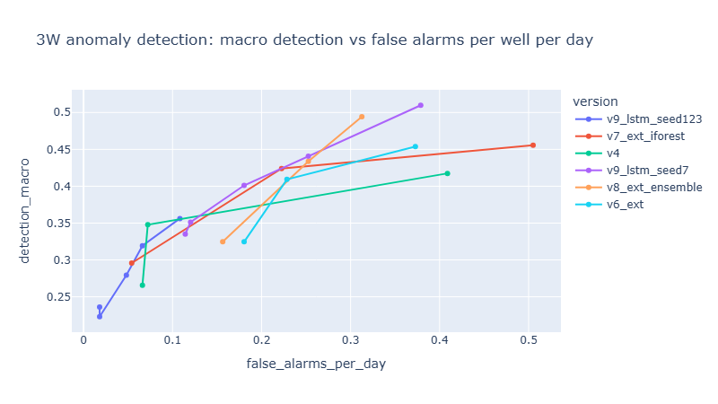

# AssetMind

**Predictive maintenance and anomaly detection for oil and gas equipment, built and evaluated the way a production team would.**

AssetMind processes multivariate sensor data from equipment operations, predicts remaining useful life, and detects developing problems in offshore oil wells. Every model is judged with leakage-safe evaluation, honest metrics and explicit uncertainty. Traditional ML (Arm A) is benchmarked first; GenAI models (Arm B) and an agentic layer follow, judged against the same scoreboard.

The project is designed around the responsibilities in an SLB Data Scientist role: processing large multivariate datasets, data-driven anomaly detection and failure prediction, engineering knowledge in feature design, visualization, and GenAI/agentic solutions.

---

## Status

| Phase | Scope | Status |
|---|---|---|
| 1 | Project setup, C-MAPSS ingestion and validation | Done |
| 2 | EDA and engineering features (C-MAPSS) | Done |
| 3 | Failure prediction: baselines, quantile intervals, conformal calibration | Done |
| 4 | Oil-well anomaly detection on Petrobras 3W | Done |
| 5 | Arm B: time-series foundation models; TF-IDF vs fine-tuned SLM on maintenance text | Planned |
| 6 | Maintenance scheduling with population-based meta-heuristics (NSGA-II) | Planned |
| 7 | LangGraph agents: data quality, diagnosis, RAG, reports, human approval | Planned |
| 8 | A/B study write-up, Streamlit dashboard, Docker | Planned |

---

## Datasets

| Dataset | Used for | Notes |
|---|---|---|
| [NASA C-MAPSS](https://data.nasa.gov/) (FD001) | Remaining useful life | 100 run-to-failure engines (train), 100 truncated engines (test) |
| [Petrobras 3W](https://github.com/petrobras/3W) v2.0.0 | Anomaly detection | 1,119 real instances from 40 offshore wells, 1 Hz sensors, 9 event types. See [`docs/3w_data_card.md`](docs/3w_data_card.md) |

Data files are not committed. See **Setup** below.

---

## Results

### Failure prediction (C-MAPSS FD001, test set, last cycle per engine)

| Model | CV RMSE | Test RMSE | NASA score |
|---|---|---|---|
| Dummy (mean) | 41.67 | 43.07 | 33,629 |
| Ridge | 15.86 | 17.18 | 454 |
| **LightGBM** | 10.02 | **12.74** | **228** |

- Features built from EDA: constant-sensor removal learned on train only, RUL capped at 125 (two-phase degradation), per-engine baseline deviation, rolling mean and slope. A unit test proves no feature uses future cycles.
- Absolute deviation from each engine's own healthy baseline turned direction-dependent core-speed sensors into consistent indicators (s_9: 71/29 engines rising/falling → 99/1).
- Uncertainty: P10–P90 quantile intervals covered 73% (target 80%). Split conformal calibration on held-out engines brought coverage to 0.82–0.92 across four seeds, with the widening reported across seeds rather than the best one.

### Oil-well anomaly detection (3W, leave-one-well-out)

Evaluation: each of the 40 wells is held out in turn; per-well baselines use only files recorded **before** the instance being scored (no-future rule); events are scored once each (detected, delay, lead time); false alarms are counted per well per day on normal operation; macro detection gives each event type an equal vote.

**Operating modes (Pareto front of stable detectors):**

| Mode | Detector | Macro detection | False alarms per well per day |
|---|---|---|---|
| Quiet | Isolation Forest on per-well z-scores, q = 0.999 | 0.28–0.30 | 0.05–0.06 |
| Balanced | Per-feature percentile scoring, q = 0.995 | 0.409 | 0.228 |
| Sensitive | Ensemble (percentile + Isolation Forest), q = 0.99 | 0.49 | 0.31–0.35 |




Ranges are across random seeds. Settings were selected after seeing leave-one-well-out results, so the front is slightly optimistic; later models must beat it.

**What is detected reliably:** DHSV closures and severe slugging (≈ 100%). **What remains hard:** flow instability depends strongly on the false-alarm budget; scaling in the production choke is essentially undetected (≤ 3 of 36).

**How the detector evolved:**

| Version | Change | Effect |
|---|---|---|
| v1 | Global robust z (std, change), max over sensors, 3 consecutive windows | DHSV 100%, slugging 84%, flow instability 1% |
| v2 | Per-well baseline with no-future rule | Better detection; per-well false alarms doubled (in-sample calibration too tight) |
| v3 | Out-of-sample calibration | v2 and v3 shown to be two points on one trade-off curve |
| Sweep | Thresholds × persistence | Pareto front; persistence nearly free; ceiling ≈ 0.47 |
| v4 | 1-hour look-back features | Same detection with ~3.5× fewer false alarms |
| v5a | + P-MON-CKP (upstream of the choke) | No gain: masked by a shared threshold of z ≈ 1,120 |
| Floor | Minimum per-well spread | Threshold 1,120 → 244 |
| v6 | Per-feature percentile scoring | Best mid-range curve; quick choke restrictions caught via P-MON-CKP |
| v5b | Level vs the well's own earlier normal | Rejected: between-file drift causes sustained false alarms |
| v7 | Isolation Forest combiner | Triples flow-instability detection; seed-sensitive at q = 0.995 |
| v8 | Percentile + forest ensemble | Best sensitive point (0.49 at ~0.31 FA/day), stable across seeds |
| v9 | LSTM autoencoder (30-window sequences) | Curve matches or extends others, but threshold calibration and per-class behavior depend on the seed; excluded from operations |

### Arm B: GenAI (Phase 5)

#### Time-series foundation model on 3W (Chronos-2, zero-shot)

Amazon Chronos-2 (120M parameters) forecasts each sensor 5 minutes ahead from 2 hours of history; the anomaly score is the forecast surprise (|actual − median| ÷ 10–90% band width), fed through the same per-well, no-future scoreboard as Arm A. Computed once on a free Colab T4 (~1 h).

| Detector | Macro detection | False alarms per well per day |
|---|---|---|
| Arm A, v4 (q = 0.995) | 0.348 | 0.072 |
| Chronos-2 only (q = 0.99) | 0.340 | 1.617 |
| Arm A + Chronos-2 feature (q = 0.999) | 0.393 | 0.457 |

- Zero-shot Chronos-2 needs ~20× more false alarms to match Arm A, and adding it to Arm A's features makes the curve worse: forecast surprise flags planned operator actions (unpredictable ≠ faulty), and overlapping forecasts make scores autocorrelated, defeating the persistence filter.
- It is complementary on **long, slow events**: it uniquely catches 3 of 4 BSW increases and 5 scaling events that Arm A misses. It cannot score files shorter than its 2-hour context (DHSV closures, flow instability).
- **Verdict:** Arm A wins on this task. Future work: shorter context, multivariate forecasting with covariates.

#### Small language model on pipeline incident text (PHMSA)

6,021 real incident narratives from US hazardous-liquid pipelines (see [`docs/phmsa_data_card.md`](docs/phmsa_data_card.md)), split by year: train 2010–2021, validation 2022–2023, test 2024–2026.

**Main task: classify the cause (7 categories), test set**

| Model | Macro-F1 | Accuracy | Inference cost |
|---|---|---|---|
| Dummy | 0.092 | 0.476 | – |
| Qwen3-4B-Instruct, zero-shot | 0.632 | 0.705 | GPU |
| TF-IDF + logistic regression | 0.730 | 0.829 | CPU, near-instant |
| **Qwen3-4B, QLoRA fine-tuned (Unsloth)** | **0.841** | **0.881** | 0.58 s/narrative (T4) |

- Fine-tuning beats TF-IDF: McNemar p = 0.00027 (75 vs 36 disagreements won); bootstrap 95% interval for the macro-F1 gain +0.059 to +0.171.
- Zero-shot errors followed PHMSA labeling conventions (blaming workers near failing equipment, repair excavations read as excavation damage, weather filed elsewhere) and ignorance of class frequencies. Fine-tuning fixed them (e.g. incorrect-operation precision 0.48 → 0.86 on validation).
- One prompt revision with hand-written conventions made zero-shot **worse** (0.594 → 0.550 on validation): fixing one confusion moved errors elsewhere.

**Side task: detect reports whose cause is still undetermined (33 positives in test)**

| Model | Precision | Recall | F1 |
|---|---|---|---|
| Keyword rule | 0.148 | 0.606 | 0.238 |
| TF-IDF + logistic regression | 0.000 | 0.000 | 0.000 |
| **Qwen3-4B, zero-shot** | 0.344 | **0.939** | **0.504** |
| Qwen3-4B, fine-tuned for causes | 0.000 | 0.000 | 0.000 |

- With only 17 training positives, supervised models fail; zero-shot reading wins.
- **Catastrophic forgetting:** the cause-tuned model never answers "undetermined" (trained only on narratives with a definite cause). Because LoRA adapters are separable, the design routes cause classification to base + adapter and pending detection to the base model alone.

**Text verdict:** with plentiful labels, a fine-tuned SLM combines language understanding with learned conventions and beats TF-IDF; with scarce labels, the zero-shot SLM wins; zero-shot alone loses to supervised TF-IDF on the main task.

**Data discoveries that shaped the evaluation:** a reporting lag (recent incidents are often still "under investigation"), supplemental conclusions appended to old narratives, and keywords such as "excavated" that appear in every cause.

### Lessons that shaped the results

- **Inspect data before trusting it.** Sensors present in 71% of files were jointly usable in 11%; a downhole gauge read exactly zero for years; "normal" files appear to be curated calm periods.
- **Compare like with like.** A naive tier comparison pointed the wrong way; a like-for-like join on the same instances reversed it.
- **Check against chance.** An apparent "1–3 h early warning" disappeared once each alarm's position was compared with a uniform baseline.
- **Look inside the model on a known case.** Aggregate scores hid a per-well threshold of z ≈ 1,120.
- **Check seeds before claiming wins.** One Isolation Forest comparison and the LSTM's per-class story did not survive other seeds.
- **Features set the ceiling, not thresholds.** Inside a 5-minute window, scaling's creep is ~1/12 of normal noise; detecting it needs adaptive baselines that 3W's disjoint snapshots cannot support.

---

## Repository structure

```
assetmind/
├── src/assetmind/
│   ├── ingestion/      cmapss.py, threew.py          # loading, validation, windowing, sensor validity
│   ├── features/       cmapss.py, threew.py          # engineered features, 1-hour look-back features
│   ├── pipelines/      build_features.py, build_3w_windows.py, build_3w_features.py
│   ├── models/         train_baselines.py, train_quantile.py, train_conformal.py,
│   │                   anomaly_baseline.py, anomaly_twotier.py, anomaly_lstm.py,
│   │                   eval_anomaly_twotier.py, sweep_anomaly_twotier.py,
│   │                   seed_check_iforest.py, eval_anomaly_lstm.py
│   └── evaluation/     metrics.py, event_metrics.py   # RMSE, NASA score, event-level detection metrics
├── notebooks/          01_cmapss_eda, 02_error_analysis, 03_3w_inspect, 04_3w_windows_eda
├── tests/              unit tests (leakage, metrics, windowing, detectors)
└── docs/               3w_data_card.md
```

`data/`, `reports/`, `mlruns/` and `mlflow.db` are generated locally and not committed.

---

## Setup

Requires Python 3.11 and [uv](https://docs.astral.sh/uv/).

```bash
uv sync
```

**C-MAPSS:** download `CMAPSSData.zip` (NASA data portal or Kaggle) and extract the `.txt` files into `data/raw/cmapss/`.

**PHMSA:** download "Hazardous Liquid Accident Data – January 2010 to present (ZIP)" from the PHMSA page and extract it into `data/raw/phmsa/`.

**GPU steps (Colab):** Chronos-2 scoring and the Qwen3-4B zero-shot and QLoRA runs use a free Colab T4; the notebooks are in `notebooks/colab/`.

**3W:** clone the dataset next to this project (it is large; `--depth 1` fetches only the latest version): 


```bash
cd ..
git clone --depth 1 https://github.com/petrobras/3W.git
```


## Running

```bash
uv run pytest -q

# Failure prediction (C-MAPSS)
uv run python -m assetmind.ingestion.cmapss
uv run python -m assetmind.pipelines.build_features
uv run python -m assetmind.models.train_baselines
uv run python -m assetmind.models.train_quantile
uv run python -m assetmind.models.train_conformal

# Anomaly detection (3W)
uv run python -m assetmind.pipelines.build_3w_windows
uv run python -m assetmind.pipelines.build_3w_features
uv run python -m assetmind.models.sweep_anomaly_twotier
uv run python -m assetmind.models.seed_check_iforest
uv run python -m assetmind.models.eval_anomaly_lstm

# Experiment tracking
uv run mlflow ui --backend-store-uri sqlite:///mlflow.db
```

---

## Known limitations

- 3W events come from few wells (some types from 2–3 wells, 4–6 files); per-class results on small classes carry roughly one file of noise (~2 macro points).
- False-alarm rates are likely optimistic: most normal hours come from curated normal files, while false alarms concentrate in unselected normal periods.
- Operating points were chosen after seeing evaluation results.
- The global (no-history) tier still causes most false alarms at the quiet end.

## Future work

- Cross-validated threshold calibration using all training wells; seed ensembles for the LSTM.
- Adaptive (recent) baselines on continuous data, needed for slow events such as scaling.
- Percentile or forest scoring for the global tier.
